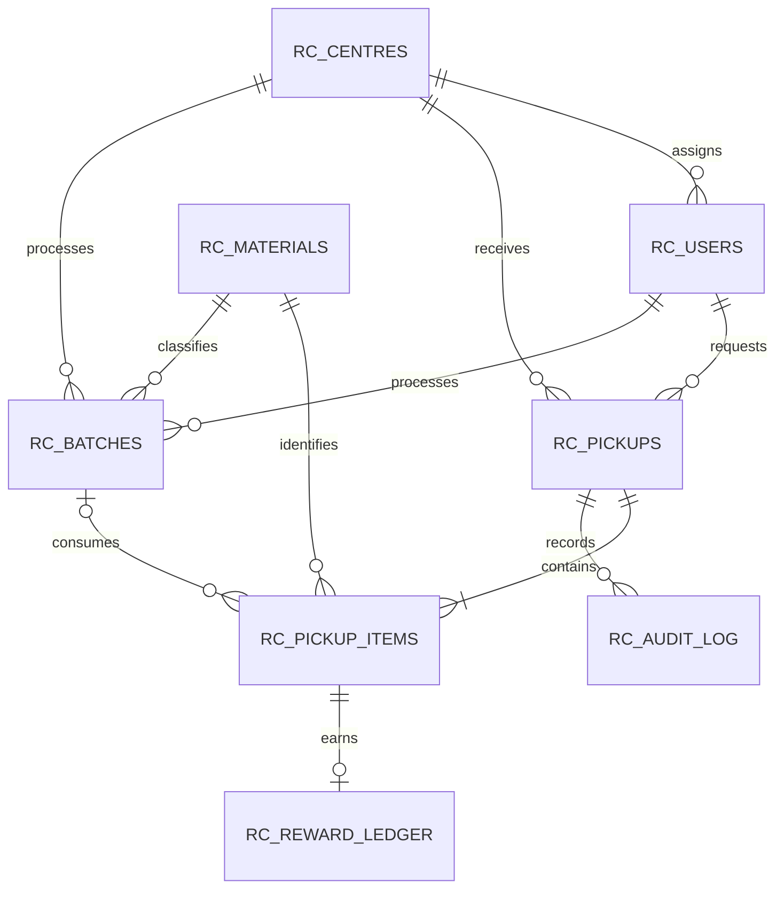

# ReLoop schema and normalization

ReLoop stores pickup requests, material lines, users, centres, processing batches, and reward entries separately. Oracle identity columns provide primary keys; foreign keys connect the records. The core relationships are:

`RC_CENTRES` holds centre facts; `RC_USERS` holds account facts and an optional centre assignment; `RC_MATERIALS` holds material names and current illustrative point rates. `RC_PICKUPS` is the request header, while `RC_PICKUP_ITEMS` stores one row per material on a request. The item constraint makes `(pickup_id, material_id)` unique. `RC_BATCHES` represents a centre/material processing event, and each item can reference its assigned batch. `RC_REWARD_LEDGER` has at most one reward row per item. `RC_AUDIT_LOG` records pickup status transitions.

## From an unnormalized sheet to 3NF

Imagine a single pickup sheet with citizen name/email, centre address, pickup date/status, and repeating columns such as `material1`, `weight1`, `material2`, `weight2`, plus reward points and batch details. Repeating material columns make the sheet hard to query and update consistently.

**First normal form (1NF):** Give each field one value and move repeated material/weight groups into separate rows. In ReLoop, each `RC_PICKUP_ITEMS` row represents one material on one pickup. The header remains one row in `RC_PICKUPS`.

**Second normal form (2NF):** With a line identified by `(pickup_id, material_id)`, keep attributes that depend on the whole line together, such as its estimated, collected, and accepted weights. Request date, citizen, centre, and address belong to the pickup header because they depend only on the pickup. Material name and current point rate belong to the material record because they depend only on the material.

**Third normal form (3NF):** Keep facts about one entity in that entity's table. A centre address is stored with the centre, citizen email with the user, and material name/rate with the material; pickup rows refer to these entities by keys. This avoids storing centre details on every line or material descriptions on every pickup. Reports join the normalized tables or use views.

Two snapshots are deliberate. `RC_PICKUPS.pickup_address` preserves the address chosen for that particular request if the citizen later changes their profile or moves. `RC_REWARD_LEDGER.rate_snapshot` preserves the rate used when those points were awarded, even if the material's current illustrative rate changes. These are historical transaction facts, not duplicated editable master data.

Weights use `NUMBER(10,3)`. Accepted weight must be nonnegative and cannot exceed collected weight. Derived totals, points balances, unprocessed input, and recovery rates are computed in views/queries instead of stored as independently editable values.

The actual DDL is in `database/01_schema.sql`; view definitions are in `database/03_views.sql`.
